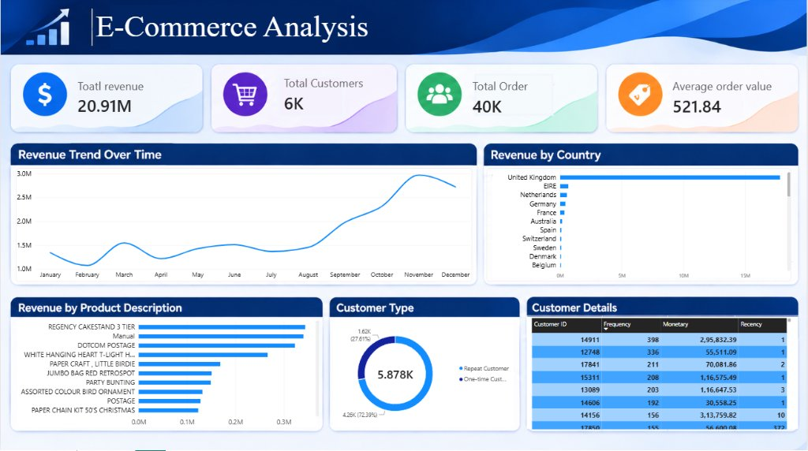

# E-Commerce Sales Analysis & Executive Dashboard

An end-to-end data analytics and business intelligence project exploring **1M+ transactional records** from a UK-based online retailer. The project features an automated Python (Pandas) ETL pipeline, advanced exploratory data analysis (EDA), RFM customer segmentation, a comprehensive executive BI dashboard, and a MySQL relational database for deep SQL querying.


---

## Executive Dashboard Overview

<p align="center">
  
</p>

The executive dashboard consolidates multi-dimensional data into five actionable views:
1. **Executive Scorecard (KPIs):** High-level summary of total revenue, order count, active customer base, and average basket value.
2. **Revenue Trend Over Time:** Monthly sales trajectory highlighting Q4 seasonal demand and holiday peaks.
3. **Geographic Distribution:** Revenue concentration across domestic (UK) and international markets.
4. **Product Performance:** Top 10 revenue-generating SKUs driving business volume.
5. **Customer Segmentation & RFM Matrix:** Repeat vs. one-time buyer distribution and high-value customer activity.

---

## Table of Contents

- [Executive Dashboard Overview](#-executive-dashboard-overview)
- [Project Overview](#-project-overview)
- [Key Business Insights](#-key-business-insights)
- [Tech Stack](#-tech-stack)
- [Project Structure](#-project-structure)
- [Getting Started](#-getting-started)
- [Pipeline Walkthrough](#-pipeline-walkthrough)
- [SQL Analysis](#-sql-analysis)
- [Future Improvements](#-future-improvements)
- [License](#-license)

---

## Project Overview

| Aspect | Detail |
|---|---|
| **Dataset** | [UCI Online Retail II](https://archive.ics.uci.edu/dataset/502/online+retail+ii) — 2 years of transactional records (Dec 2009 – Dec 2011) |
| **Data Volume** | 1,067,371 raw records across multiple Excel sheets |
| **Objective** | Clean messy transactional data, uncover revenue drivers, segment customers via RFM, and build an interactive executive dashboard |
| **Architecture** | Python ETL Pipeline → EDA & Visualization → MySQL Database → Business Intelligence Dashboard |

---

## Key Business Insights

### 1. Executive KPIs

| KPI Metric | Value | Business Takeaway |
|---|---|---|
| **Total Revenue** | **£20.91M** | Total net sales generated over the 2-year period |
| **Total Orders** | **40,079** | Unique validated invoices processed |
| **Active Customers** | **5,878** | Unique customer accounts identified |
| **Units Sold** | **11.39M** | Total quantity of merchandise shipped |
| **Average Order Value (AOV)** | **£521.84** | Healthy average spend per transaction |

---

### 2. Deep-Dive Dashboard Findings

- ** Strong Q4 Seasonality:**
  - Revenue remains steady from January to August (~£1.2M–£1.5M/month) before experiencing exponential growth in September and October.
  - **November is the peak month** approaching **£2.9M–£3.0M**, driven by early holiday shopping and wholesale pre-orders.
- ** Geographic Concentration:**
  - The **United Kingdom** represents **over 85% of total revenue (~£17.8M+)**.
  - Top international markets are led by **EIRE (~£664K)**, **Netherlands (~£554K)**, **Germany**, and **France**, demonstrating clear European cross-border traction.
- ** High-Velocity Products:**
  - The highest revenue-producing merchandise is dominated by giftware and home decor:
    - `REGENCY CAKESTAND 3 TIER`
    - `WHITE HANGING HEART T-LIGHT HOLDER`
    - `PAPER CRAFT, LITTLE BIRDIE`
    - `JUMBO BAG RED RETROSPOT` & `PARTY BUNTING`
- ** Customer Retention (The 80/20 Rule):**
  - **Repeat Buyers (72.39% / 4,255 customers)** drive **over 82% of all company revenue (£17.1M)**.
  - **One-time Buyers (27.61% / 1,623 customers)** contribute only £566K, underscoring customer retention and loyalty programs as the single biggest growth lever.
- ** VIP RFM Profiles:**
  - Top customer accounts (such as ID `14911` and `14156`) exhibit ultra-high frequency (150–400 orders) and monetary spend exceeding **£290,000+**, with recent transactions (Recency ≤ 2 days).

---

## Tech Stack

| Technology | Role in Project |
|---|---|
| **Python 3.10+** | Pipeline scripting, automation, and data wrangling |
| **Pandas & NumPy** | Data ingestion, multi-sheet joins, cleaning, transformation, and aggregations |
| **Matplotlib & Seaborn** | Exploratory statistical visualization and chart export |
| **Power BI / Canvas BI** | Interactive executive dashboard design, KPI scorecards, and visual storytelling |
| **MySQL Relational DB** | Production-ready storage for analytical querying |
| **SQLAlchemy & PyMySQL** | Python-to-MySQL ORM & chunked database bulk loader |
| **python-dotenv** | Environment variable management for credential protection |

---

## Project Structure

```
ecommerce-sales-analysis/
│
├── assets/                         # Dashboard & repository images
│   └── dashboard.png               # High-resolution executive dashboard screenshot
│
├── data/
│   ├── raw/                        # Original source data (ignored by git)
│   │   └── online_retail.xlsx
│   └── processed/                  # Transformed datasets (ignored by git)
│       ├── all_transactions.csv
│       ├── sales_clean.csv
│       └── cancellations.csv
│
├── output/                         # Analysis summaries & exported charts
│   ├── kpis.csv
│   ├── monthly_sales.csv
│   ├── country_sales.csv
│   ├── product_sales.csv
│   ├── invoice_summary.csv
│   ├── customer_rfm.csv
│   ├── customer_type_summary.csv
│   ├── data_quality_report.csv
│   ├── monthly_revenue.png
│   ├── top_countries.png
│   └── top_products.png
│
├── src/                            # Python ETL & Analytics source code
│   ├── load_data.py                # Ingestion: Multi-sheet Excel → merged CSV
│   ├── clean_data.py               # Data hygiene: Deduplication, cancellations, feature engineering
│   ├── analyze.py                  # Exploratory data analysis, KPI calculations, RFM segmentation
│   └── load_mysql.py               # Database loader: Chunked batch inserts into MySQL
│
├── sql/                            # Production SQL analysis scripts
│   ├── ecommerce_create_database.sql # Database schema initialization
│   └── analysis_queries.sql        # Business insight queries (AOV, RFM, Top products, Country ranking)
│
├── .env                            # Local database credentials (ignored by git)
├── .gitignore                      # Git exclusion rules
├── requirements.txt                # Python package dependencies
└── README.md                       # Project documentation
```

---

## Getting Started

### 1. Prerequisites
- Python 3.10 or higher
- MySQL Server (optional — for SQL querying)

### 2. Installation & Setup

1. **Clone the repository:**
   ```bash
   git clone https://github.com/Rednarock016/Ecommerce-sales-analysis.git
   cd Ecommerce-sales-analysis
   ```

2. **Create and activate a virtual environment:**
   ```bash
   # Windows
   python -m venv venv
   venv\Scripts\activate

   # macOS / Linux
   python3 -m venv venv
   source venv/bin/activate
   ```

3. **Install dependencies:**
   ```bash
   pip install -r requirements.txt
   ```

4. **Download the raw dataset:**
   - Download the [Online Retail II dataset](https://archive.ics.uci.edu/dataset/502/online+retail+ii) from the UCI Machine Learning Repository.
   - Place the file in `data/raw/online_retail.xlsx`.

5. **Configure environment variables (optional for MySQL):**
   - Create a `.env` file in the root directory:
     ```env
     DB_HOST=localhost
     DB_PORT=3306
     DB_NAME=ecommerce_create
     DB_USER=root
     DB_PASSWORD=your_password
     ```

---

## Pipeline Walkthrough

Run the pipeline steps sequentially from the project root:

### Step 1 — Ingest Raw Data
```bash
python src/load_data.py
```
- Reads all sheets from `online_retail.xlsx`.
- Normalizes schemas, tags origin sheets with `SourceSheet`, and validates mandatory fields.
- Saves raw merged output to `data/processed/all_transactions.csv`.

### Step 2 — Clean & Feature Engineer
```bash
python src/clean_data.py
```
- Removes **12,133 duplicate rows**.
- Segregates **22,890 cancellation entries** (`Invoice` prefixed with 'C' or negative quantities) into a dedicated table.
- Removes invalid unit prices (£0.00) and missing dates.
- Generates key features: `Revenue = Quantity * Price`, `Year`, `Month`, and `YearMonth`.
- Produces `data/processed/sales_clean.csv` and `output/data_quality_report.csv`.

### Step 3 — Analyze, Segment & Visualize
```bash
python src/analyze.py
```
- Generates business metric reports in `output/` (`kpis.csv`, `monthly_sales.csv`, `country_sales.csv`, etc.).
- Computes **RFM (Recency, Frequency, Monetary)** scores per customer.
- Segments repeat vs. one-time buyers.
- Generates Matplotlib & Seaborn reference charts.

### Step 4 — MySQL Ingestion (Optional)
```bash
python src/load_mysql.py
```
- Performs batch inserts (5,000 records/batch) into the MySQL `sales` table for rapid SQL querying.

---

## SQL Business Analysis

After loading the cleaned dataset into MySQL, execute the ready-made queries in [`sql/analysis_queries.sql`](sql/analysis_queries.sql):

| Business Question | SQL Logic / Focus |
|---|---|
| **Total Gross Revenue** | `SUM(Revenue)` across all validated orders |
| **Order Volume & Unique Customers** | `COUNT(DISTINCT Invoice)`, `COUNT(DISTINCT Customer ID)` |
| **Average Order Value (AOV)** | Total Revenue divided by unique completed transactions |
| **Monthly Revenue Trend** | Aggregated spend grouped by `YearMonth` |
| **Top 10 Export Markets** | Ranked country totals excluding domestic UK |
| **Top 10 High-Margin SKUs** | Revenue ranked by `StockCode` and `Description` |
| **VIP Customer Identification** | Highest cumulative spend customers (`Top 20`) |
| **Repeat vs. One-Time Cohorts** | Subquery grouping customers by invoice counts |

---

## Future Improvements

- [ ] Add an automated **CI/CD data validation** pipeline with Great Expectations.
- [ ] Implement **time-series revenue forecasting** using Prophet / ARIMA.
- [ ] Build **market basket analysis (association rules)** to recommend product cross-sells.
- [ ] Deploy an automated **Docker container** to run the scheduled ETL pipeline.

---

## License

This project is licensed under the MIT License — open-source for educational and portfolio purposes.

---

<p align="center">
  <b> If you find this project informative or helpful, please give it a star! </b>
</p>
