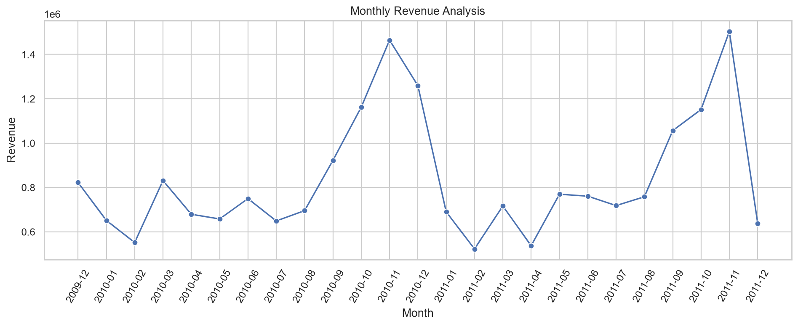
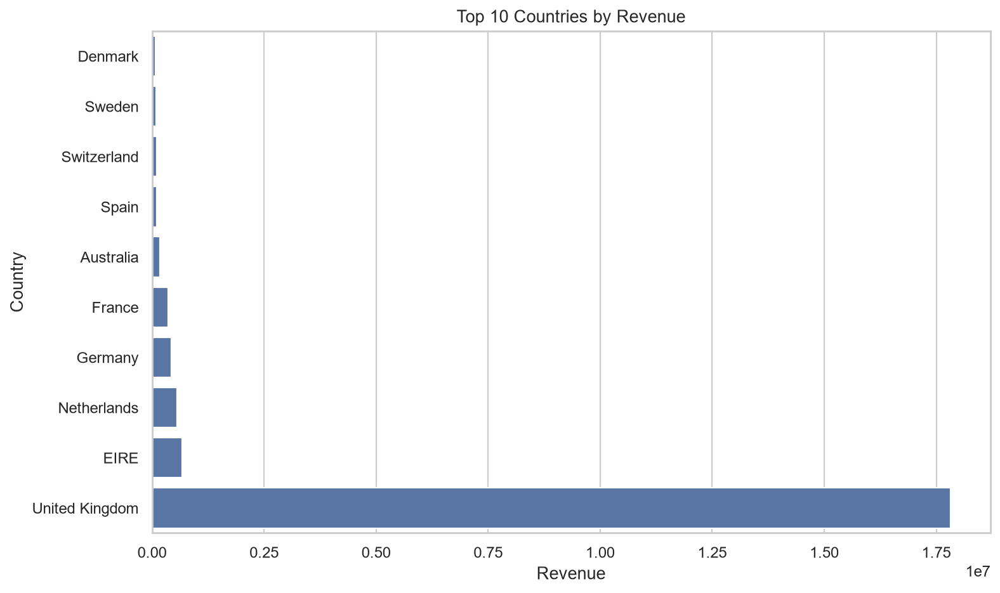
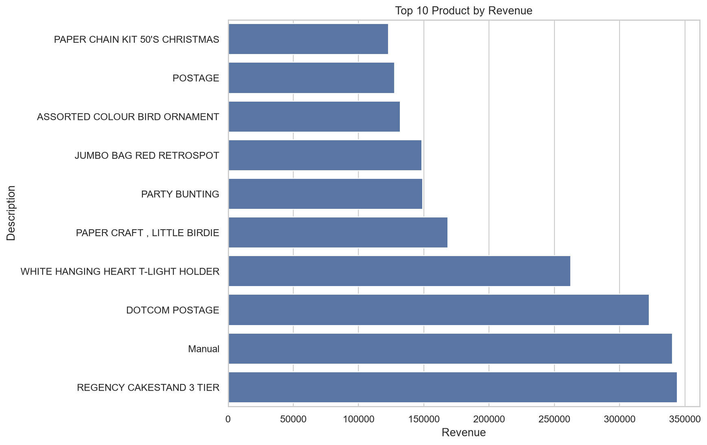

# E-Commerce Sales Analysis

An end-to-end data analytics project that explores **1M+ transactional records** from a UK-based online retailer. The pipeline ingests raw Excel data, cleans and transforms it with Python (Pandas), performs exploratory data analysis with visualizations, and optionally loads the results into a MySQL database for SQL-based querying.


---

## Table of Contents

- [Project Overview](#-project-overview)
- [Key Findings](#-key-findings)
- [Tech Stack](#-tech-stack)
- [Project Structure](#-project-structure)
- [Getting Started](#-getting-started)
- [Pipeline Walkthrough](#-pipeline-walkthrough)
- [Visualizations](#-visualizations)
- [SQL Analysis](#-sql-analysis)
- [Future Improvements](#-future-improvements)

---

## Project Overview

| Aspect | Detail |
|---|---|
| **Dataset** | [UCI Online Retail II](https://archive.ics.uci.edu/dataset/502/online+retail+ii) — transactions from a UK online retailer (Dec 2009 – Dec 2011) |
| **Records** | 1,067,371 raw rows across multiple Excel sheets |
| **Goal** | Extract actionable business insights around revenue, customers, products, and geography |
| **Approach** | Python ETL pipeline → EDA & visualization → MySQL for SQL analysis |

---

## Key Findings

### Business KPIs

| KPI | Value |
|---|---|
| **Total Revenue** | £20.91M |
| **Total Orders** | 40,079 |
| **Unique Customers** | 5,878 |
| **Units Sold** | 11.39M |
| **Average Order Value** | £521.82 |

### Highlights

-  **Peak revenue months** — November consistently leads (~£1.5M), driven by holiday season demand.
-  **United Kingdom dominates** — 85% of total revenue (£17.8M), followed by EIRE (£664K) and the Netherlands (£554K).
-  **Repeat customers drive the business** — 4,255 repeat buyers generated £17.1M (82% of revenue), while 1,623 one-time buyers contributed only £566K.
-  **Data quality** — 12,133 duplicate rows removed; 22,890 cancellation records separated; 236K rows missing Customer IDs.

---

## Tech Stack

| Tool | Purpose |
|---|---|
| **Python 3.10+** | Core programming language |
| **Pandas** | Data loading, cleaning, transformation, and aggregation |
| **Matplotlib & Seaborn** | Data visualization and chart generation |
| **MySQL** | Relational database for SQL-based analysis |
| **SQLAlchemy & PyMySQL** | Python ↔ MySQL connectivity |
| **openpyxl** | Reading multi-sheet `.xlsx` files |
| **python-dotenv** | Secure environment variable management |

---

## Project Structure

```
ecommerce-sales-analysis/
│
├── data/
│   ├── raw/                        # Original dataset (not tracked by Git)
│   │   └── online_retail.xlsx
│   └── processed/                  # Cleaned CSVs (generated by pipeline)
│       ├── all_transactions.csv
│       ├── sales_clean.csv
│       └── cancellations.csv
│
├── output/                         # Analysis results & charts
│   ├── kpis.csv
│   ├── monthly_sales.csv
│   ├── country_sales.csv
│   ├── product_sales.csv
│   ├── invoice_summary.csv
│   ├── customer_rfm.csv
│   ├── customer_type_summary.csv
│   ├── data_quality_report.csv
│   ├── monthly_revenue.png
│   ├── top_countries.png
│   └── top_products.png
│
├── src/                            # Python source code
│   ├── load_data.py                # Step 1: Ingest raw Excel → CSV
│   ├── clean_data.py               # Step 2: Clean, transform, split
│   ├── analyze.py                  # Step 3: EDA, KPIs, charts
│   └── load_mysql.py               # Step 4: Upload to MySQL (optional)
│
├── sql/                            # SQL scripts
│   ├── ecommerce_create_database.sql
│   └── analysis_queries.sql
│
├── .env                            # Database credentials (not tracked)
├── .gitignore
├── requirements.txt
└── README.md
```

---

## Getting Started

### Prerequisites

- Python 3.10 or higher
- MySQL Server (optional — only for Step 4)

### Installation

1. **Clone the repository**

   ```bash
   git clone https://github.com/Rednarock016/ecommerce-sales-analysis.git
   cd ecommerce-sales-analysis
   ```

2. **Create and activate a virtual environment**

   ```bash
   python -m venv venv

   # Windows
   venv\Scripts\activate

   # macOS / Linux
   source venv/bin/activate
   ```

3. **Install dependencies**

   ```bash
   pip install -r requirements.txt
   ```

4. **Download the dataset**

   Download [Online Retail II](https://archive.ics.uci.edu/dataset/502/online+retail+ii) from UCI and place the file as:

   ```
   data/raw/online_retail.xlsx
   ```

5. **Configure MySQL (optional)**

   Create a `.env` file in the project root:

   ```env
   DB_HOST=localhost
   DB_PORT=3306
   DB_NAME=ecommerce_create
   DB_USER=root
   DB_PASSWORD=your_password
   ```

---

## Pipeline Walkthrough

Run each step sequentially from the project root:

### Step 1 — Load Raw Data

```bash
python src/load_data.py
```

- Reads all sheets from `online_retail.xlsx`
- Merges them into a single DataFrame with a `SourceSheet` column
- Validates expected columns (`Invoice`, `StockCode`, `Description`, `Quantity`, `InvoiceDate`, `Price`, `Customer ID`, `Country`)
- Saves → `data/processed/all_transactions.csv`

### Step 2 — Clean & Transform

```bash
python src/clean_data.py
```

- Removes **12,133 duplicate** rows
- Separates **22,890 cancellation** records (invoices starting with "C" or negative quantities)
- Filters out rows with missing dates, zero/negative quantities or prices
- Engineers new features: `Revenue`, `Year`, `Month`, `YearMonth`
- Saves → `data/processed/sales_clean.csv` and `cancellations.csv`
- Outputs → `output/data_quality_report.csv`

### Step 3 — Analyze & Visualize

```bash
python src/analyze.py
```

Generates:

| Output | Description |
|---|---|
| `kpis.csv` | Total revenue, orders, customers, units sold, AOV |
| `monthly_sales.csv` | Revenue aggregated by year-month |
| `country_sales.csv` | Revenue by country (43 countries) |
| `product_sales.csv` | Revenue and units sold per product |
| `invoice_summary.csv` | Per-order revenue, date, country, customer |
| `customer_rfm.csv` | RFM (Recency, Frequency, Monetary) per customer |
| `customer_type_summary.csv` | Repeat vs. one-time customer breakdown |
| `monthly_revenue.png` | Monthly revenue trend line chart |
| `top_countries.png` | Top 10 countries bar chart |
| `top_products.png` | Top 10 products bar chart |

### Step 4 — Load into MySQL (Optional)

```bash
python src/load_mysql.py
```

- Reads `sales_clean.csv` and uploads it to a MySQL `sales` table
- Uses SQLAlchemy with chunked inserts (5,000 rows per batch)
- Requires `.env` credentials to be configured

---

## Visualizations

### Monthly Revenue Trend

> Revenue peaks in November of both years, correlating with pre-holiday shopping. A seasonal trough is visible in February.



### Top 10 Countries by Revenue

> The United Kingdom contributes the vast majority of revenue. EIRE, Netherlands, Germany, and France round out the top 5.



### Top 10 Products by Revenue

> Highest-revenue products highlight popular product categories and potential items for promotional focus.



---

## SQL Analysis

After loading data into MySQL (Step 4), run the queries in [`sql/analysis_queries.sql`](sql/analysis_queries.sql):

| Query | Purpose |
|---|---|
| Total Revenue | `SUM(Revenue)` across all sales |
| Total Orders | `COUNT(DISTINCT Invoice)` |
| Total Customers | `COUNT(DISTINCT Customer ID)` |
| Average Order Value | Revenue per unique invoice |
| Monthly Revenue | Revenue grouped by `YearMonth` |
| Top 10 Countries | Countries ranked by total revenue |
| Top 10 Products | Products ranked by revenue with units sold |
| Top 20 Customers | Highest-spending customers |
| Customer Segmentation | Repeat vs. one-time customer classification |
| AOV by Country | Average order value per country |

---

## Future Improvements

- [ ] Build an interactive **Power BI / Tableau dashboard**
- [ ] Add **time-series forecasting** (Prophet / ARIMA) for revenue prediction
- [ ] Implement **customer cohort analysis** and churn prediction
- [ ] Perform **market basket analysis** (association rules) for product recommendations
- [ ] Automate the pipeline with **Airflow** or a scheduled script
- [ ] Add unit tests and data validation with **Great Expectations**

---

## License

This project is open-source and available for educational and portfolio purposes.

---

<p align="center">
  <b> If you found this project helpful, consider giving it a star!</b>
</p>
